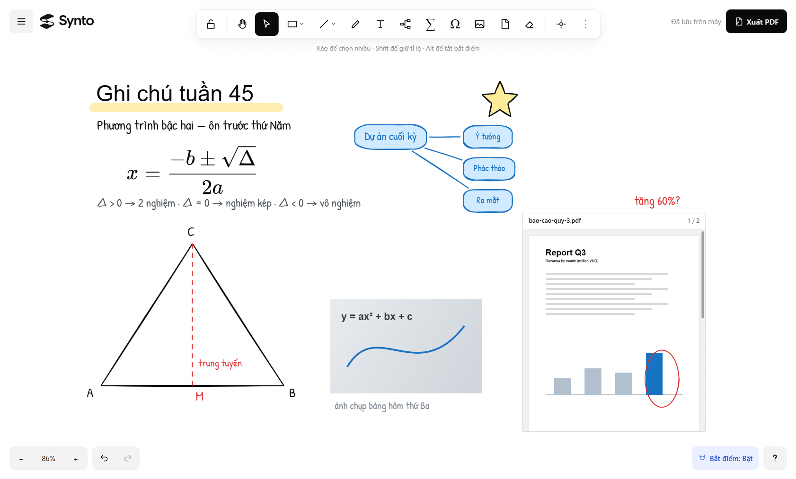
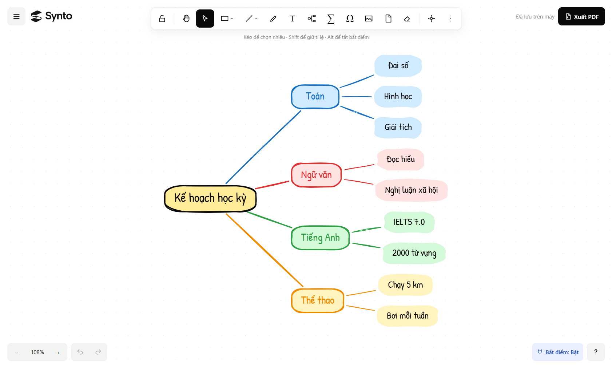
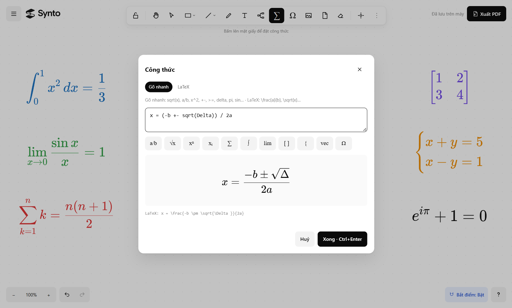
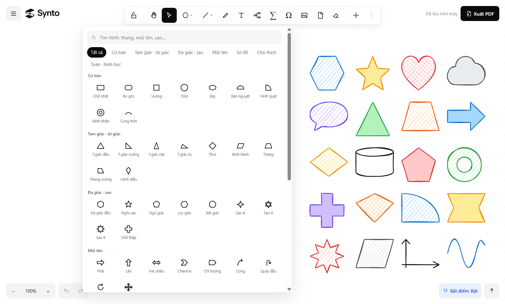
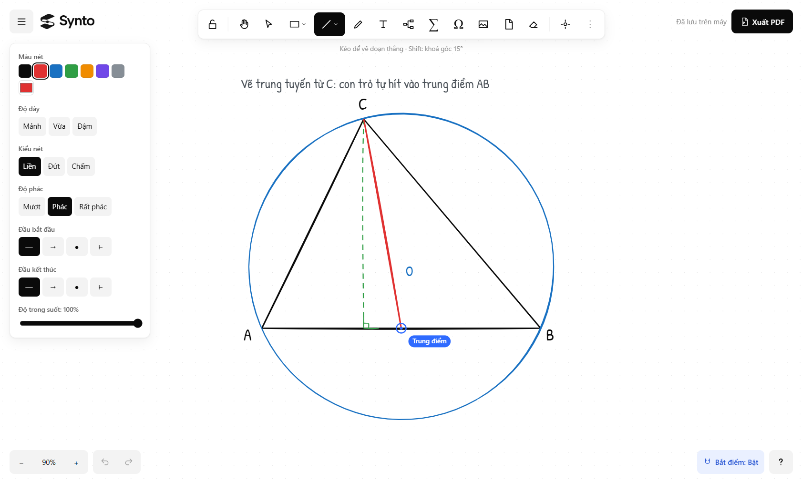
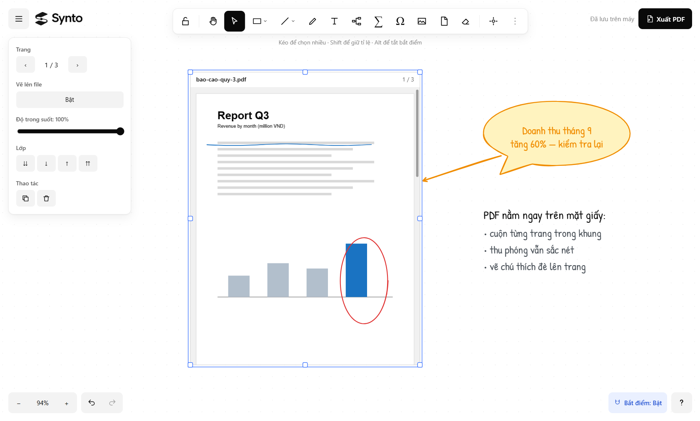
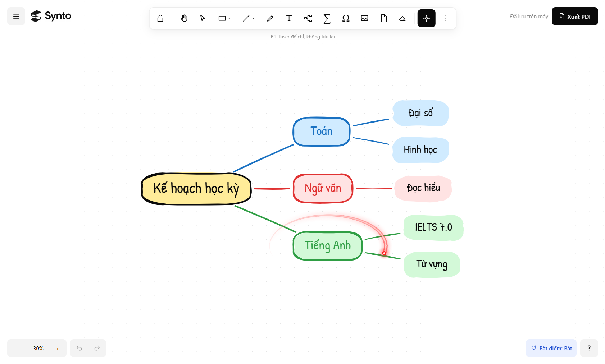
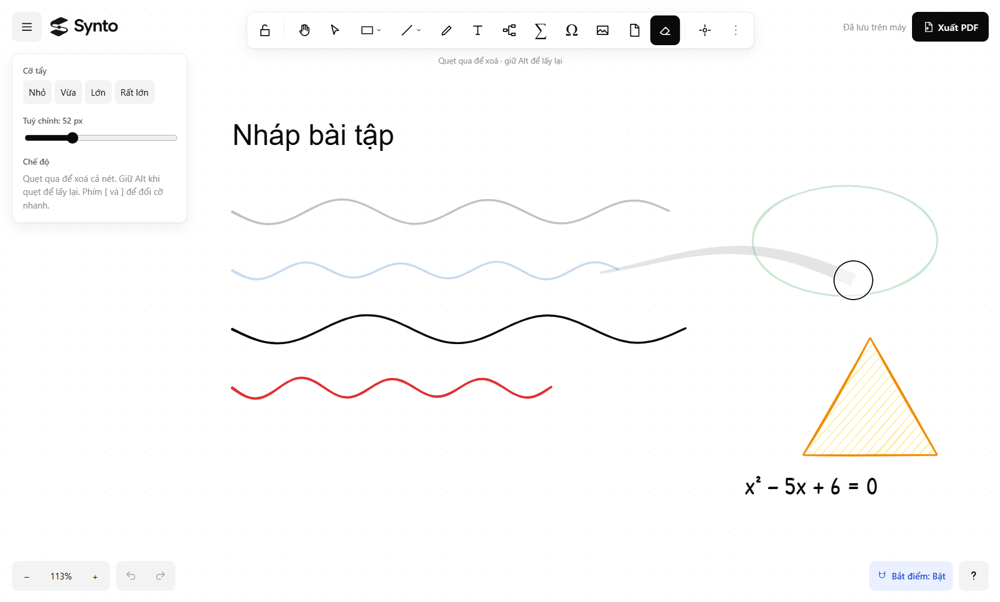
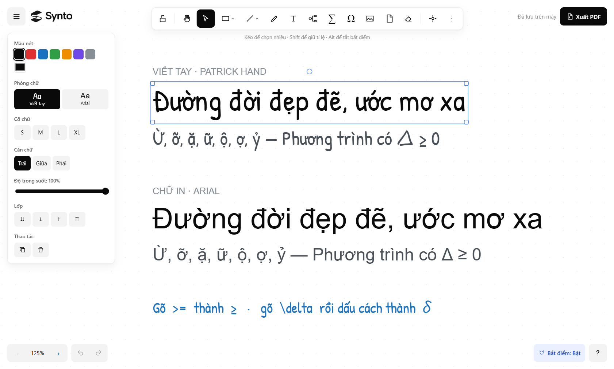
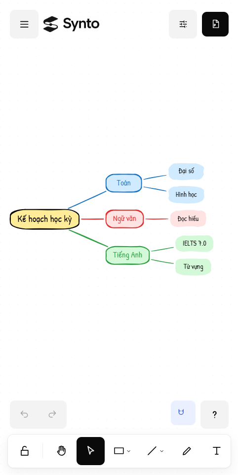

# Bộ ảnh giới thiệu Synto

Mọi ảnh đều chụp từ **app thật** (bản exe), không dựng lại hay chỉnh sửa. Mỗi cảnh được một kịch bản trong
`scripts/marketing/` tự dựng, rồi `scripts/make-screenshots.ps1` chụp vùng nội dung cửa sổ ở độ phân giải gốc
(1682×1013, riêng ảnh điện thoại 482×963). Giao diện đổi thì chạy lại lệnh để có bộ ảnh mới:

```
powershell -ExecutionPolicy Bypass -File scripts\make-screenshots.ps1
```

| Ảnh | Tính năng | Gợi ý câu quảng cáo |
|---|---|---|
|  | **Tổng quan**: ghi chú, công thức, hình học, sơ đồ tư duy, ảnh và PDF trên cùng một mặt giấy vô tận | *Mọi thứ bạn học và làm, trên một trang giấy không giới hạn.* |
|  | **Sơ đồ tư duy** kiểu XMind: Tab thêm nhánh con, Space thêm nhánh ngang hàng, nhánh tô màu | *Tab là nhánh con, Space là nhánh ngang hàng. Ý tưởng chảy nhanh như bạn nghĩ.* |
|  | **Công thức** đẹp như sách: gõ nhanh `sqrt(x)`, `a/b` hoặc LaTeX, xem trước ngay | *Gõ như nói, hiện ra như sách giáo khoa.* |
|  | **63 hình phẳng** trong 7 nhóm, nét phác tay, tô gạch / chéo / đặc | *63 hình, một phong cách vẽ tay riêng.* |
|  | **Bắt điểm tự động**: đỉnh, trung điểm, tâm, giao điểm, vuông góc | *Vẽ hình học chính xác mà vẫn tự nhiên như vẽ tay.* |
|  | **PDF ngay trên mặt giấy**: cuộn trang, thu phóng, vẽ chú thích, nối ghi chú bằng mũi tên | *Đọc, khoanh, ghi chú tài liệu PDF ngay cạnh ý tưởng của bạn.* |
|  | **Bút laser** để trình bày, vệt sáng tự tắt | *Trình bày như có bút laser thật.* |
|  | **Tẩy** quẹt qua là mờ, thả ra mới xoá; chỉnh được cỡ | *Tẩy nhẹ nhàng, đổi ý vẫn kịp.* |
|  | **Chữ tiếng Việt chuẩn**: Patrick Hand và Arial đủ dấu, tự thay ký hiệu | *Tiếng Việt đủ dấu, đẹp ở mọi nét chữ.* |
|  | **Giao diện thu gọn** cho cửa sổ hẹp và điện thoại | *Màn hình nhỏ vẫn đủ công cụ.* |

Nội dung trong ảnh là dữ liệu mẫu (kế hoạch học kỳ, ôn phương trình bậc hai, báo cáo quý), không phải dữ liệu
của người thật.
